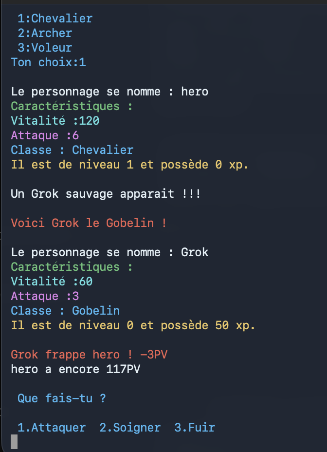
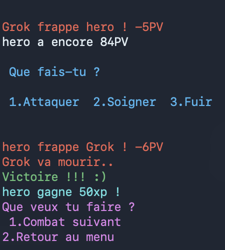

# Mini-RPG en C

Un jeu de combat au tour par tour dans le terminal, que je code en C pour apprendre le langage.

## Pourquoi ce projet

Je suis en première année de BTS CIEL. En cours de prog on refait surtout des petits exemples, et j'avais du mal à m'y mettre. Je savais qu'en C il fallait beaucoup pratiquer, mais j'avais envie de voir à quoi ressemble un vrai programme, plus long, avec des fonctions, des structures, etc.

Donc je me suis lancé dans un petit RPG, et je l'améliore étape par étape. C'est pas toujours fluide, ça demande pas mal d'effort, mais je sens que j'avance et ça m'a donné envie de m'y intéresser encore plus.

Le projet est en cours : j'en suis à 8 étapes sur les 10 que je me suis fixées.

## Le jeu

Tu donnes un nom à ton héros et tu choisis sa classe :

| Classe | PV | Attaque | Or au départ | |
|---|---|---|---|---|
| Chevalier | 120 | 6 | 30 | il encaisse mais tape pas fort |
| Archer | 95 | 7 | 5 | entre les deux |
| Voleur | 80 | 9 | 10 | fragile mais il fait mal |

Chaque héros commence avec une potion.

Ensuite un monstre te tombe dessus, tiré au hasard dans un bestiaire (il attaque en premier, c'est une embuscade) :

| Monstre | PV | Attaque | XP | Or |
|---|---|---|---|---|
| Pétunia la Fleur | 30 | 1 | 40 | 5 |
| Grok le Gobelin | 60 | 3 | 50 | 10 |
| Ursus l'Ours | 70 | 4 | 130 | 15 |
| Draco le Dragon | 130 | 12 | 200 | 20 |

Bon courage si tu tombes sur Draco au niveau 1.

À chaque tour tu choisis d'attaquer, de te soigner, de tenter de fuir (avec une chance sur deux que ça marche) ou de boire une potion, qui rend 40 PV. Les dégâts et les soins sont tirés au hasard : un coup fait entre l'attaque du perso et le double (un Chevalier tape entre 6 et 11), et un soin rend entre 5 et 14 PV.

Quand tu gagnes, tu récupères de l'XP et de l'or. À 100 XP ton héros monte de niveau. Avec l'or, tu peux acheter des potions à la boutique (20 pièces la potion) juste après chaque victoire. Tu peux enchaîner les combats avec le même héros, mais tes PV ne remontent pas entre deux combats, donc il faut gérer.

À quoi ressemble une partie :



Et la fin d'un combat :



## Pour tester

Il faut juste un compilateur C. Je code sur Mac, ça devrait marcher pareil sur Linux.

```bash
git clone https://github.com/nicode-labs/mini-rpg-c.git
cd mini-rpg-c
gcc rpg.c -o rpg -Wall
./rpg
```

## Ce que j'ai appris

1. **Le menu** : `printf`, `scanf`, `switch` et une boucle `do … while`.
2. **La fiche du héros** : les `struct`, et le texte avec les tableaux de `char`.
3. **Les classes et le premier combat** : le hasard avec `rand`, `strcpy`, les `if / else`.
4. **Le combat en boucle** : là le jeu est devenu jouable. J'ai découvert les fonctions (au début j'avais rien compris, puis ça a fait tilt quand je les ai vues comme des combos dans un jeu de baston) et mes premiers pointeurs.
5. **Attaquer, se soigner, fuir** : une variable `fuite` pour sortir de la boucle, et un `pvMax` pour pas dépasser sa vie max en se soignant.
6. **L'XP et les niveaux** : quand passer une struct par adresse ou par copie, et la portée des variables.
7. **Le bestiaire** : un tableau de `struct`. Je copie le monstre tiré au hasard avant le combat, sinon il serait déjà mort au combat suivant.
8. **L'or, la boutique et les potions** : au lieu d'écrire une deuxième fonction de soin pour la potion, j'ai donné la quantité de soin en paramètre à `soigner`. Une seule fonction, deux usages.

Les bugs qui m'ont le plus appris :

- Mon héros avait **-216858240** de vitalité. J'affichais une valeur que j'avais pas encore remplie, et en C une variable vide contient n'importe quoi.
- Quand je choisissais 1 dans le menu, ça affichait toutes les réponses d'un coup. J'avais oublié les `break` dans mon `switch`.
- Ma fonction d'attaque enlevait pas les PV, parce qu'elle travaillait sur une copie du perso. Il fallait lui donner son adresse. C'est comme ça que j'ai compris les pointeurs.
- Mon attaque montait jamais en passant de niveau : `attaque *= 1.12` sur un `int`, et 4,48 ça devient 4.
- Un warning que je comprenais pas du tout. En lançant le jeu j'ai vu que `%d` s'affichait tel quel : le `%` que j'avais tapé c'était pas le bon caractère. Depuis, quand je comprends pas un warning, je lance le programme et je regarde ce qu'il affiche.
- Pétunia n'apparaissait jamais : avec `rand() % 3`, je ne pouvais tirer que les cases 0, 1 et 2, et elle était dans la case 3.
- J'avais écrit `or =- 20` au lieu de `or -= 20`. Ça compile sans erreur, mais ça veut dire « l'or devient -20 ». Mon héros finissait endetté après chaque achat.
- Et un faux bug : le jeu relançait une partie tout seul… parce que j'avais tapé 1 et Entrée plusieurs fois trop vite.

## La suite

- [x] Menu principal
- [x] Fiche du héros
- [x] Classes et premier combat
- [x] Combat en boucle
- [x] Attaquer, se soigner, fuir
- [x] XP et niveaux
- [x] Plusieurs types de monstres
- [x] Or, boutique et potions
- [ ] Sauvegarder sa partie
- [ ] Découper le code en plusieurs fichiers

Bugs que je connais et que je corrigerai : le nom du héros doit faire un seul mot, et si tu tapes une lettre au lieu d'un chiffre dans un menu, le jeu part en boucle.

À la fin, je prévois aussi de rééquilibrer le jeu (surtout Draco) et d'ajouter un peu de visuel dans le terminal : des cadres et des barres de vie.

## Comment je bosse

Le code, c'est moi qui l'écris, sur mon Mac avec VS Code et le terminal. Pour la structure du projet, je me fais accompagner par une IA (Claude) : découpage en étapes, organisation du code, et explication des notions quand je bloque. Je note aussi tout ce que je fais et les bugs que je rencontre dans un carnet de bord.

---

Nico.G, étudiant en BTS CIEL au lycée Félix Le Dantec à Lannion, en reconversion vers l'informatique et la cybersécurité.